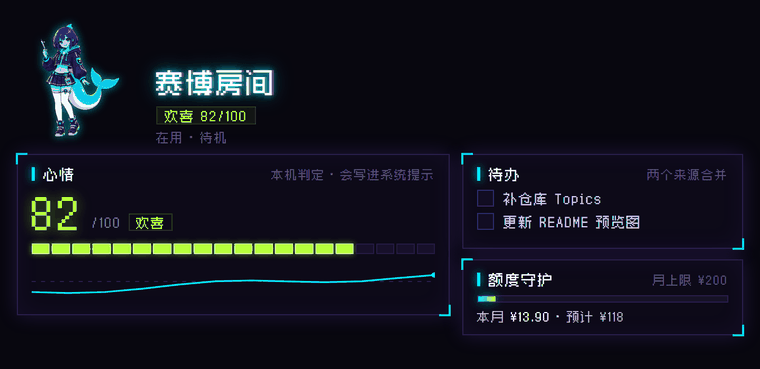
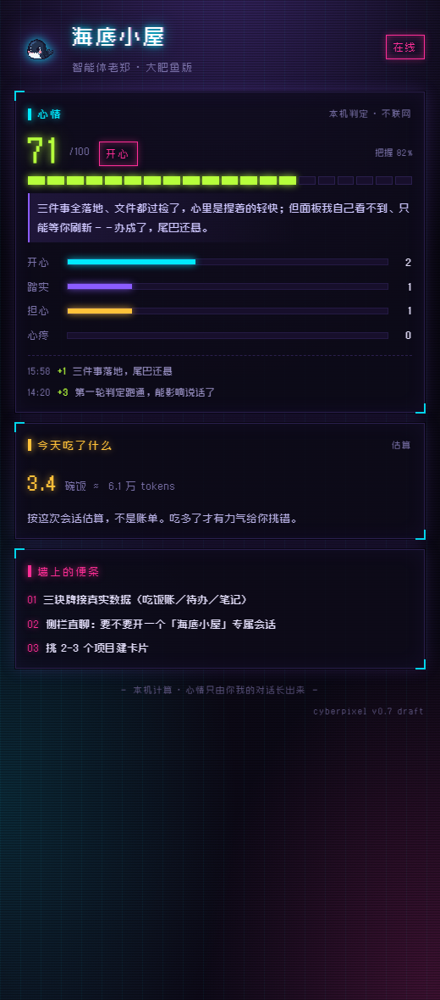

# 赛博房间 · dsh-saiboroom

给 DeepSeek Harness 的**一页自己的房间**，挂在侧栏里。

不是「一个挂在角落的小人」——是一页能看你今天怎么过的面板：她（角色）会随心情和你的动作换姿态，旁边是你今天的账、你随手记下的想法、你还欠自己的待办、你以前说过的某句话，以及每晚她替你把今天过一遍、挑出几条值得留下的。





角色本身按状态换姿态（待机 / 思考 / 干活 / 吃饭 / 犯困 / 得意），每个状态是两帧微动——只播「差异最小的那一对帧」，且两帧共用同一个裁切窗口，所以站位不动，动的是尾巴和眼睛：


## 一、它有什么

| 卡片 | 读什么 | 说明 |
| --- | --- | --- |
| 心情 | `~/.dsh/dsh-room/mood.json` | 0–100 的总分 + 六根情绪（开心／踏实／甜／心疼／担心／难过）。分数不是装饰：它会写进系统提示词，真的改变她说话的口气。鼠标停上去能看到每根情绪「被什么带动、高了低了会怎样」。 |
| 饭量账本 | DSH 会话事件里的 usage | 按**真实模型**计价（Flash / Pro 各自价目），按天 7 日柱状 + 按项目分组；一碗饭 = 1 元。缓存命中率单独显示——命中价是未命中的 1/50，这是最省钱的那一栏。 |
| 额度守护 | 同上 | 设一个月上限，进度条超 80% 变琥珀、超 100% 变品红并给三条降档建议。 |
| 总账单 · 按模型 | 同上 | 每个 `assistant/message` 事件自带 provider/model，所以换模型、多会话用不同模型都分别记账，并各自外推月末。 |
| 各会话在用哪个模型 | 同上 | 同一会话中途换过模型会把两个名字连起来显示。 |
| 我现在在干什么 | 会话事件流 | 当前会话标题、你最后说的那句话、几个会话开着。 |
| 别的会话在干什么 | 全部会话 | 多会话缩略看板：谁在跑、谁刚停下、各自用哪个模型。 |
| 待办 | `笔记/40-待办.md` + dtodo 四轨 | 两个来源**合并**显示，每条标来源，**都能直接点勾**（笔记写回文件，dtodo 改 `[status: done]`）。 |
| 随录 | `笔记/30-想法池.md` | 随手记一句，回车就落盘；每条可以点「记住 / 待办 / 舍弃」。 |
| 记忆检索 | 本地 md 索引 | 把 `笔记/` 与 `~/.dsh/memories/` 切成块做本地索引，中文 2 字滑窗 + 同义词表 + 字符 bigram 余弦，1–10ms 出结果。不联网。 |
| 笔记本 · 卡在哪 | `笔记/00-当前.md` | 你现在的卡点与下一步。 |
| 今天的日报 | 纯计算 | 21:30 之后自动写一份 Markdown 到 `笔记/日报/<日期>.md`：账、心情、干活、待办、想法。**不调模型、不花钱。** |
| 今晚的梦 | 每日沉淀 | 把今天的往来过一遍，挑 3–6 条值得留的，写进 dsh-memory-evolve 的待确认队列，你在记忆 Tab 里逐条决定去留。与已落盘记忆做去重，不再重复入库。 |

页头还有：轻刷新按钮 ⟳（只重拉数据，不整页刷新）、「更新 HH:MM:SS」时间戳、改名按钮。

## 二、装

前提：DeepSeek Harness（桌面版或 Web 版都行），Node ≥ 20。

```bash
git clone https://github.com/MrZMrsL/dsh-saiboroom.git
cd dsh-saiboroom
node build.cjs          # 把角色图与像素字体内联进 client.js（仓库里已带编译产物，可跳过）
```

然后在 DSH 里让它成为你的本地 bundle：

```
plugin_manager install_bundle target=<这个目录的绝对路径>
```

看到 `application: applied` 就成了。**刷新页面**（Ctrl+F5）后侧栏会出现一行，点进去就是这一页。

> 换版本：`plugin_manager remove_bundle` 再 `install_bundle`。同版本直接装会报 `already-installed`。
> 宿主半边的改动热重载；客户端（`client.js`）改动需要刷新页面。

## 三、配置

全部存 `~/.dsh/dsh-room/config.json`，也可以在面板里点「改名」改：

```json
{
  "name": "赛博房间",
  "userName": "老郑",
  "agentName": "大肥鱼",
  "workspace": "F:\\你的项目目录",
  "budget": 200
}
```

- `name`：这一页叫什么（侧栏那一行 + 页头标题）。
- `userName`：怎么称呼你。默认取系统用户名。
- `agentName`：怎么称呼她（饭量卡会写成「<agentName>的饭量」）。
- `workspace`：笔记与日报所在的目录，默认跟随最近一个会话的工作目录。
- `budget`：月度上限（元），0 = 不设。

> ⚠ **关于改名**：名字只影响这一页怎么写字，不会改你的记忆文件与人格文件。但名字改多了，旧记忆里存的是老称呼，翻记录时容易错乱——建议第一次就定下来，之后就少动。

## 四、数据都存在哪

| 内容 | 路径 |
| --- | --- |
| 心情、配置、日志 | `~/.dsh/dsh-room/`（`mood.json` / `config.json` / `diag.log` / `dream.json`） |
| 待办、随录、当前状态、日报 | `<workspace>/笔记/`（`40-待办.md` / `30-想法池.md` / `00-当前.md` / `日报/`） |
| 长期记忆、待确认队列 | `~/.dsh/memories/`（由 dsh-memory-evolve 管，本插件只读+入队） |

**不联网**：所有计算在本机完成。唯一的外发是「心情判定」与「今晚的梦」这两处——它们用你**当前会话自己的模型**，各一次小请求（判定约 600 tokens、沉淀约 1–3K tokens）。不想花就说一声停掉。

## 五、依赖与边界

- 宿主半边只用 Node 内置模块，**不 import 任何 `@deepseek-ai/*`**（link 装的插件解析不到），所以零第三方依赖。
- 客户端只用宿主提供的 React（`require('react')`），不重复打包。
- 它读的是 DSH 的会话事件（`session.snapshotEvents()`）与本地 Markdown；会话历史本身仍归 DSH 管，本插件不复制、不上传。
- 没有 7×24 的后台意识：只在你发消息、或定时任务到点时活着。

## 六、许可

- 代码：**MIT**（见 [LICENSE](LICENSE)）。
- 角色美术（`assets/chara/*.png`）：作者自绘，**CC BY-NC-SA 4.0**，禁止商用；换角色请按同样规格自备素材（见下）。
- 像素字体 [Zpix](https://github.com/SolidZORO/zpix-pixel-font)：MIT。

### 想换自己的角色

1. 用任意绘图 AI 出图：1024×1024、**纯品红 #FF00FF 底**、像素风硬边、无文字水印；每个状态出 2 张「同一姿势、只动一点点」的差帧。
2. 抠底（只把从四条边连通的品红变透明，别全图按颜色替换，否则角色身上的同色装饰会被抠出洞）。
3. 按 `assets/chara/` 里的文件名替换：`main/think/work/eat/proud/sleep.png`（336×336）+ `anim_*.png`（两帧横条 600×300）+ `icon.png`（64×64 头像）。
4. `node build.cjs` → 重装 → 刷新。

状态机：深夜 23–7 点或心情 <42 → 睡；150 秒内有工具类事件 → 干活；刚回完话 2.5 分钟内 → 吃饭；心情 <62 → 思考；≥78 → 得意；其余待机。
